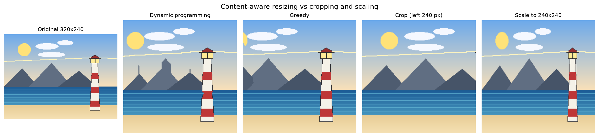
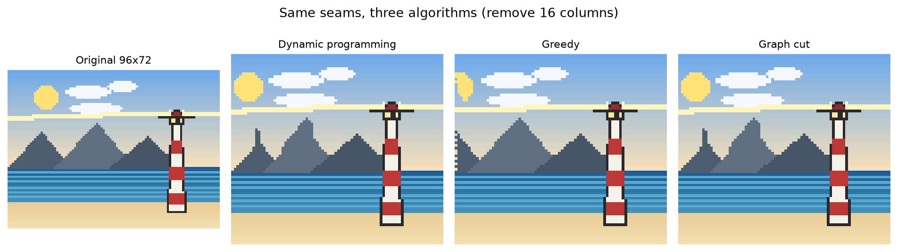
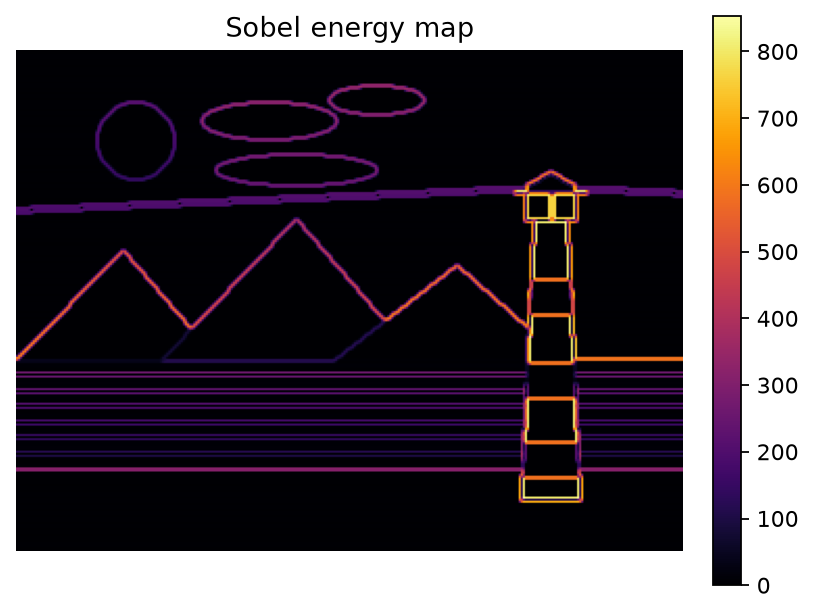
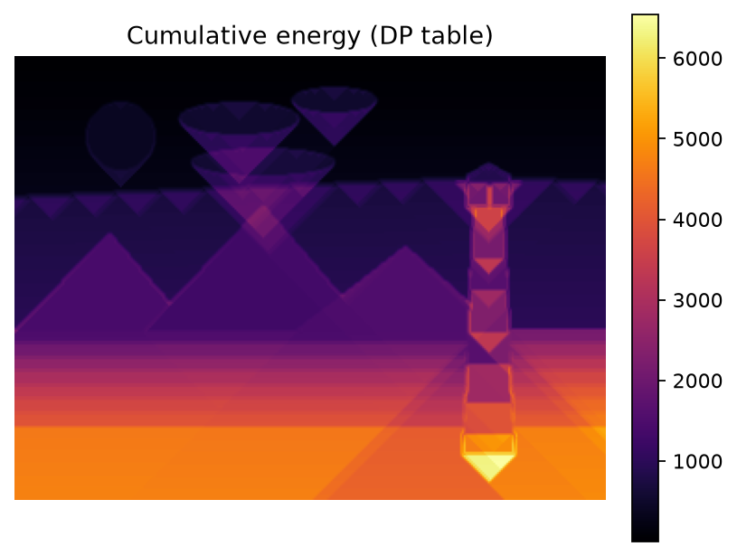
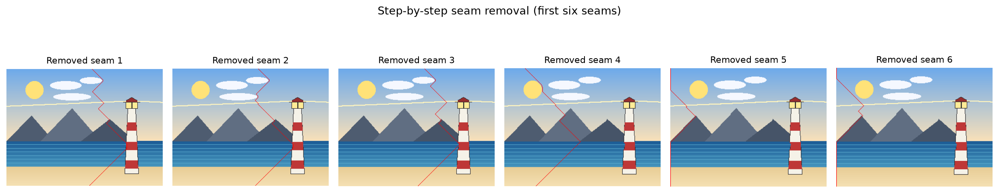
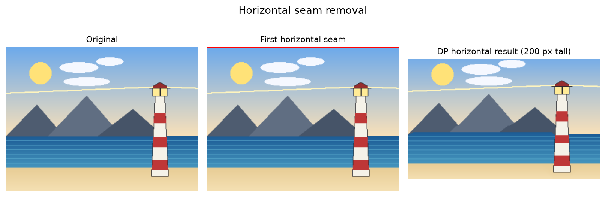
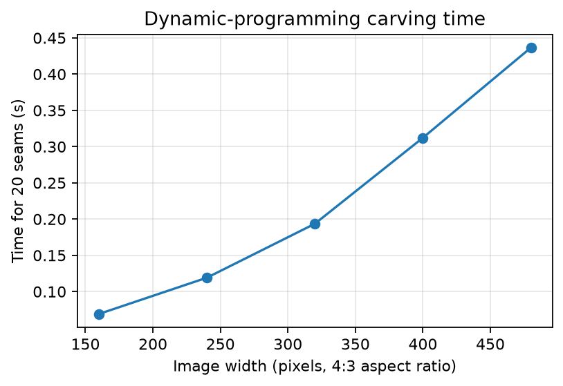

# Assignment 2: Image Compression by Seam Carving

**Team ID:** T23

| Member | SIT ID |
|---|---|
| Ong Jay Tong | 2402370 |
| Liew Wen Shan | 2402504 |
| Tristan Tham Rui Hong | 2200794 |
| Ching Wei An | 2202589 |
| Mohammad Shahrin Idzuan Bin Iswandi | 2403171 |
| Amirul Syafiq Bin Mohamed Faizul | 2403212 |

**Code:** https://github.com/jjjjto/Algo2

**Presentation video:** TODO: add the recorded video URL before submission.

---

## Contents

1. [Introduction](#1-introduction)
2. [Answers to the theory questions (Item 2)](#2-answers-to-the-theory-questions-item-2)
3. [Algorithm design](#3-algorithm-design)
4. [Implementation](#4-implementation)
5. [Results and evaluation](#5-results-and-evaluation)
6. [Analysis and discussion](#6-analysis-and-discussion)
7. [Bonus features](#7-bonus-features)
8. [AI usage declaration](#8-ai-usage-declaration)
9. [References](#9-references)

---

## 1. Introduction

Seam carving is a content-aware image resizing technique introduced by Avidan
and Shamir [1]. Instead of removing rows or columns blindly, it removes
*seams*: connected paths of pixels with low visual importance. A vertical seam
contains exactly one pixel in every row, and neighbouring pixels in the seam
are vertically or diagonally adjacent. A horizontal seam does the same across
columns.

The algorithm has three repeating steps:

1. Compute an **energy map**. Edges and detailed regions get high energy;
   flat regions get low energy.
2. Find the **minimum-energy seam** with an optimisation algorithm.
3. **Remove the seam**, recompute the energy map, and repeat until the image
   reaches the requested size.

This project implements the seam finder with three algorithms:

| Algorithm | Optimal for the energy map? | Main idea |
|---|---|---|
| Dynamic programming (DP) | Yes | Solve the recurrence for every pixel in O(HW) |
| Greedy | No | Choose the cheapest neighbour row by row |
| Graph cut | Yes | Minimum s-t cut, solved with Dinic max-flow |

Both vertical and horizontal seams are supported. The project also includes a
command-line tool, an interactive Tkinter application, step-by-step
visualisations, unit tests, and a CI workflow.

**Libraries.** NumPy is used for arrays and fast vectorised arithmetic, Pillow
for reading and writing images, and Matplotlib for report figures. No
content-aware resizing function from any image library is used. Every seam
finder, energy map, and seam removal routine is implemented in this
repository.

---

## 2. Answers to the theory questions (Item 2)

### 2.1 Number of seams grows at least exponentially in m

Let the image have `m` rows and `n > 1` columns. Consider only the first two
columns, 0 and 1. In every row, a seam can choose column 0 or column 1. If two
adjacent rows choose the same column, the seam moves vertically. If they
choose different columns, it moves diagonally. Both moves are allowed by the
definition of a seam.

Therefore every binary sequence of length `m` describes a valid seam. There
are `2^m` such sequences, so the number of seams is at least `2^m`. This is
exponential in `m` (more precisely, `Ω(2^m)`). The restriction `n > 1` is
needed because with one column there is only one possible seam.

The total number of seams is even larger, but this lower bound is enough to
show that checking every seam by brute force is impractical.

### 2.2 Dynamic programming and the subproblem relation

Let `e[i, j]` be the energy of pixel `(i, j)`, with rows numbered from 0 at the
top. Define `total[i, j]` as the minimum total energy of a seam that starts in
row 0 and ends at pixel `(i, j)`.

**Base case.** A seam that ends in the first row has only one pixel:

```
total[0, j] = e[0, j]
```

**Recurrence.** A seam that ends at `(i, j)` must come from `(i-1, j-1)`,
`(i-1, j)`, or `(i-1, j+1)`. Taking the cheapest predecessor gives:

```
total[i, j] = e[i, j] + min(
    total[i-1, j-1],
    total[i-1, j],
    total[i-1, j+1]
)
```

Out-of-range columns are treated as infinity. The best seam in the whole image
ends at the column `j*` that minimises `total[m-1, j]`. Walking back through the
chosen predecessors rebuilds the seam.

**Optimal substructure.** If the best seam to `(i, j)` used a non-optimal seam
to one of its predecessors, replacing that prefix with the better one would
produce a cheaper seam to `(i, j)`, which is a contradiction.

**Overlapping subproblems.** The value `total[i-1, j]` is reused by the three
pixels `(i, j-1)`, `(i, j)`, and `(i, j+1)`. Storing each value once avoids
recomputing the same prefix many times.

The table has `H*W` entries, and each entry takes constant work, so the time
complexity is `O(H*W)` per seam. The space complexity is `O(H*W)` for the full
table and the parent pointers. Section 6.2 discusses how to reduce the space.

Horizontal seams use exactly the same recurrence after transposing the energy
map: columns become rows, and the same code solves the problem.

### 2.3 Can divide and conquer improve the Sobel computation?

For a fixed 3×3 Sobel kernel, convolution is already linear in the number of
pixels: every pixel reads a constant number of neighbours. The direct
computation is `O(H*W)`.

A divide-and-conquer convolution splits the image into blocks. Each block
needs a one-pixel halo because a pixel near a block boundary reads neighbours
from the adjacent block. Copying or recomputing those halos adds work at every
level. With four half-size blocks per level, the recurrence is
`T(N) = 4T(N/4) + O(N)`, which solves to `O(N log N)` for a naive recursive
split. That is worse than the direct `O(N)` method, not better.

There are related optimisations that do help:

- **Separability.** The Sobel operator is separable. A 3×3 Sobel convolution
  can be computed as a 1-D horizontal pass followed by a 1-D vertical pass.
  This reduces the multiplications per pixel and is a constant-factor win.
- **Vectorisation and parallelism.** NumPy computes the whole energy map with
  array operations, and the blocks of a divide-and-conquer scheme can run in
  parallel. This improves wall-clock time on multicore hardware but does not
  change the asymptotic complexity.
- **FFT convolution.** For very large kernels, FFT-based convolution can beat
  direct convolution. A 3×3 kernel is far too small for that to pay off.

**Conclusion.** Divide and conquer does not improve the asymptotic efficiency
of a 3×3 Sobel energy map. Direct, separable, vectorised convolution is the
right choice. Divide and conquer is useful for parallel execution or for huge
kernels, not for the Sobel case in this assignment.

---

## 3. Algorithm design

### 3.1 Energy map

The energy of a pixel measures how disruptive removing it would be. This
project uses the Sobel gradient magnitude:

```
Gx = [[-1, 0, 1],      Gy = [[-1, -2, -1],
      [-2, 0, 2],            [ 0,  0,  0],
      [-1, 0, 1]]            [ 1,  2,  1]]

energy[i, j] = sqrt(Gx[i, j]^2 + Gy[i, j]^2)
```

The RGB image is first converted to grayscale with the standard luminance
weights `0.299 R + 0.587 G + 0.114 B`. The border is padded by edge
replication, so the output has the same shape as the input.

High energy means a strong edge; seam carving avoids those pixels. Flat sky,
water, and walls have low energy and are removed first.

**Why grayscale?** It keeps the energy map simple and fast. A colour-aware
alternative computes the gradient of each channel and sums the magnitudes.
That can help when two colours have the same luminance but a strong colour
edge. It is listed as a possible improvement in Section 6.4.

**Alternative energy: forward energy.** The basic gradient measures the
current image. Removing a seam also creates new adjacencies between pixels
that were not neighbours before. Forward energy charges the seam for those new
edges and usually produces fewer artefacts [2]. This project uses Sobel as the
assignment suggests and discusses forward energy as future work.

### 3.2 Dynamic programming

The recurrence from Section 2.2 is implemented with NumPy. For each row, the
three predecessor rows are built with shifted arrays, then the element-wise
minimum and the arg-min are taken:

```python
previous = total[i - 1]
left = np.full(w, INF)
left[1:] = previous[:-1]
right = np.full(w, INF)
right[:-1] = previous[1:]

choices = np.stack((left, previous, right))
total[i] = energy[i] + choices.min(axis=0)
parent[i] = choices.argmin(axis=0) - 1
```

`parent[i, j]` stores `-1`, `0`, or `+1`, meaning the chosen predecessor was
left, above, or right. After filling the table, the bottom row's minimum gives
the end of the optimal seam, and the parent table rebuilds it from bottom to
top.

Ties are broken in favour of the left predecessor because `argmin` returns the
first minimum and the stack order is `(left, up, right)`. The tie-break does
not affect the seam's energy.

**Complexity.** `O(H*W)` time and `O(H*W)` space per seam. Removing `k` seams
costs `O(k*H*W)` because the energy map is recomputed after every removal.

### 3.3 Greedy algorithm

The greedy seam starts at the minimum-energy pixel in the top row. For each
following row it moves to the cheapest of the three reachable columns:
`j-1`, `j`, or `j+1`.

```python
seam = [int(np.argmin(energy[0]))]
for i in range(1, h):
    j = seam[-1]
    candidates = [c for c in (j - 1, j, j + 1) if 0 <= c < w]
    seam.append(min(candidates, key=lambda c: energy[i, c]))
```

The greedy algorithm is fast: `O(H*W)` time and `O(H)` space. It is not
optimal because it never looks at future rows. A cheap pixel now can force an
expensive pixel later. The test suite contains a 3×3 counterexample where
greedy costs 50 and DP costs 1:

```
[[  0,  1, 100],
 [100, 50,   0],
 [100, 100,  0]]
```

Greedy takes column 0, then column 1, then column 2 (cost 50). DP starts at
column 1, then column 2, then column 2 (cost 1).

### 3.4 Graph cut (minimum s-t cut)

The seam-finding problem can be written as a minimum cut. One node is created
for every pixel. Two special nodes are added: a source `s` and a sink `t`.

For a vertical seam of an `H × W` energy map:

- Add an infinite-capacity edge `s → (i, 0)` for every row, so column 0 is on
  the source side.
- Add an edge `(i, W-1) → t` with capacity `e[i, W-1]`. This is the cost of
  ending the seam at the last column.
- For every horizontal neighbour, add `(i, j) → (i, j+1)` with capacity
  `e[i, j]`.
- Add an infinite-capacity backward edge `(i, j+1) → (i, j)`.
- Add infinite-capacity diagonal edges `(i, j) → (i-1, j-1)` and
  `(i, j) → (i+1, j-1)`.

The backward edges force the source side of the cut to be a prefix of every
row. The diagonal edges force the prefix length to change by at most one
between adjacent rows. Therefore the boundary of the prefix is a valid seam,
and the rightmost source-side pixel in each row is the seam pixel to remove.
The cut capacity equals the sum of the seam's energies.

By the max-flow min-cut theorem, the minimum cut has the same value as the
maximum flow. The implementation uses Dinic's algorithm: BFS builds a level
graph, and DFS sends a blocking flow. After the flow finishes, a BFS from the
source in the residual graph gives the source side of the minimum cut.

**A correctness detail.** The assignment sketch connects the last column to
the sink with infinite capacity. That would make it impossible for the cut to
cross the last column, so a seam on the right border could never be chosen
even when it is optimal. This implementation uses capacity `e[i, W-1]` on
those sink edges instead. The test suite checks the first-column and
last-column cases directly, and compares graph-cut cost with DP on random
maps.

**Complexity.** The graph has `V = H*W + 2` nodes and `E = O(H*W)` edges.
Dinic's worst-case bound is `O(V^2 E)` for general graphs, with `O(V + E)`
space. On the grid graphs used here the practical running time is much better,
but it is still noticeably slower than the linear-time DP.

### 3.5 Removing seams, horizontal seams, and insertion

**Removal.** A vertical seam has one column index per row. Row `i` keeps
columns `0 .. j-1` and `j+1 .. W-1`. The implementation fills a new array of
shape `(H, W-1, 3)`; it does not mutate the input.

**Why recompute the energy map?** Removing a seam changes the neighbours of
the pixels next to it. If the old energy map were reused, later seams would be
chosen using stale gradient information. Recomputing after every removal is
slower but correct, and it is what the assignment specifies.

**Horizontal seams.** A horizontal seam has one row index per column. The
cleanest implementation transposes the image, runs the vertical pipeline, and
transposes the result back. This reuses the DP, greedy, and graph-cut code
without duplicating it. The returned seam is still a list of row indices, one
per original column.

**Insertion (enlarging).** The library also supports inserting a seam. It
finds the minimum-energy seam and duplicates each of its pixels, which widens
the image by one column. The energy map is recomputed between insertions.
Duplication is simple but can produce visible streaks; averaging the seam
pixel with its neighbour is a smoother alternative and is mentioned in
Section 6.4. The GUI exposes insertion one seam at a time.

**Cost of resizing by k seams.** Each iteration computes the energy map
(`O(H*W)`) and finds and removes one seam (`O(H*W)` for DP and greedy). The
total is `O(k*H*W)` time and `O(H*W)` space. Graph cut replaces the seam-finding
step with max-flow, so its total is `O(k * maxflow(H*W))`.

### 3.6 Cropping and scaling baselines

Two standard baselines are included for comparison:

- **Cropping** keeps a fixed rectangle and throws away everything outside it.
  It is `O(1)` to choose the rectangle, but it can delete important content.
- **Scaling** resizes the whole image. It keeps all content, but it changes
  the aspect ratio of objects when the width and height are changed by
  different factors.

Seam carving keeps the important content and the aspect ratio of objects, at
the cost of more computation.

---

## 4. Implementation

### 4.1 Repository layout

```
seam_carving/
  energy.py      Sobel energy map and grayscale conversion
  dp.py          dynamic-programming seam finder and seam energy
  greedy.py      greedy seam finder
  graphcut.py    min-cut graph construction and Dinic max-flow
  carve.py       remove/insert seams, carve_width, carve_height, resize
  visualize.py   seam overlays, energy figures, step images, GIFs
  cli.py         command-line tool
  gui.py         interactive Tkinter application
tests/           52 pytest tests
scripts/
  generate_assets.py   deterministic sample images
  run_experiments.py   report figures and results tables
report/
  report.md            this report
  results.md           generated measurements
  figures/             generated figures
slides/               presentation outline and script
.github/workflows/ci.yml
```

The code uses small pure functions with type hints and docstrings. The
`FINDERS` dictionary maps a method name to a seam-finder function, so the CLI
and GUI do not need long `if/elif` chains:

```python
FINDERS = {
    "dp": find_vertical_seam,
    "greedy": find_vertical_seam_greedy,
    "graphcut": find_vertical_seam_graphcut,
}
```

`carve_width` returns a `CarveResult` dataclass with three fields:

- `image`: the resized image,
- `seams`: the seams that were removed,
- `energies`: the energy of each seam at the moment it was removed.

The energy list makes the comparison in Section 5 possible without changing
the carving code.

### 4.2 Key functions

| Function | Input | Output |
|---|---|---|
| `sobel_energy(image)` | RGB or grayscale image | `(H, W)` energy map |
| `find_vertical_seam(energy)` | energy map | `H` column indices |
| `find_horizontal_seam(energy)` | energy map | `W` row indices |
| `find_vertical_seam_greedy(energy)` | energy map | `H` column indices |
| `find_vertical_seam_graphcut(energy)` | energy map | `H` column indices |
| `remove_vertical_seam(image, seam)` | image and seam | image with one column removed |
| `carve_width(image, target, finder)` | image, target width, finder | `CarveResult` |
| `carve_height(image, target, finder)` | image, target height, finder | `CarveResult` |
| `enlarge_width(image, target, finder)` | image, target width, finder | `CarveResult` |
| `resize(image, width, height, finder)` | image, target size | image and the two results |

### 4.3 Running the project

```bash
# Install dependencies
python -m pip install -r requirements.txt

# Shrink an image with dynamic programming
python -m seam_carving.cli assets/scene.png out/scene_240.png --width 240

# Compare with greedy
python -m seam_carving.cli assets/scene.png out/scene_greedy.png --width 240 --method greedy

# Save an energy map, one image per seam, and an animated GIF
python -m seam_carving.cli assets/scene.png out/demo.png --width 260 \
    --energy out/energy.png --seams-dir out/steps --gif out/carving.gif

# Interactive application
python -m seam_carving.gui

# Tests and report figures
python -m pytest -q
python scripts/generate_assets.py
python scripts/run_experiments.py
```

### 4.4 Testing strategy

The test suite has 52 tests. The most important checks are:

- **Brute-force optimality.** On small 4×4 maps, `find_vertical_seam` is
  compared with an exhaustive search over every valid seam.
- **Graph cut vs DP.** On random 6×5 maps, the graph-cut seam must have the
  same energy as the DP seam. The tests also cover seams on the first column,
  the last column, a single-column image, and a horizontal seam.
- **Greedy counterexample.** The 3×3 map above proves that greedy is not
  optimal.
- **Seam validity.** Every seam has the correct length, columns are in range,
  and adjacent pixels differ by at most one column.
- **Pixel preservation.** Removing a seam keeps every pixel that is not on the
  seam, in the same order.
- **Insertion.** A duplicated seam increases the width by one and duplicates
  the expected pixels.
- **Target sizes.** `carve_width` and `carve_height` produce the requested
  shape and the expected number of seams.
- **CLI end-to-end.** A subprocess runs the real command, checks the output
  image size, and checks that seam-step images and the GIF exist.
- **Visualisation.** Overlays change only seam pixels; energy images, step
  images, comparison figures, and GIFs are written successfully.
- **GUI smoke test.** The window is built and destroyed; the test skips when no
  display is available.

The tests run in GitHub Actions on Python 3.10, 3.11, and 3.12. The workflow
also generates the assets and runs a real CLI command, so a broken import or a
broken image path fails CI.

### 4.5 Programming practice

- External input (images, targets, seams) is validated at the boundary.
- Invalid targets raise `ValueError` with a clear message.
- The graph-cut implementation rejects negative or non-finite energies,
  because max-flow capacities must be non-negative.
- Pure functions return new arrays instead of mutating their inputs.
- The same vertical code handles horizontal seams through transposition.
- NumPy vectorisation keeps the DP fast without making the recurrence
  unreadable.
- The generated figures and tables are reproducible from
  `scripts/run_experiments.py`.

---

## 5. Results and evaluation

### 5.1 Experimental setup

The measurements were produced by `scripts/run_experiments.py` on Windows 11
with Python 3.12, NumPy, Pillow, and Matplotlib. Times are single-run
wall-clock measurements in seconds. The sample images are generated
deterministically by `scripts/generate_assets.py`:

- `assets/scene.png`: 320×240 lighthouse scene,
- `assets/scene_small.png`: 96×72 version for the graph-cut comparison,
- `assets/shapes.png`, `assets/portrait.png`, `assets/gradient.png`.

The raw measurements are in [`results.md`](results.md).

### 5.2 Dynamic programming vs greedy

The large image is 320×240. Both methods remove 80 columns to reach 240×240.

| Method | Output | Seams | Total seam energy | First seam energy | Time (s) |
|---|---|---|---|---|---|
| DP | 240×240 | 80 | 392,678.5 | 4,290.3 | 0.680 |
| Greedy | 240×240 | 80 | 469,627.8 | 5,395.3 | 0.217 |

DP's total seam energy is 16.4% lower than greedy's. Greedy is about 3.1×
faster, but it removes more disruptive pixels. The visual difference is shown
in Figure 1.



*Figure 1. Seam carving with DP and greedy, compared with cropping and
scaling. Cropping removes the lighthouse on the right; scaling squashes the
scene; seam carving keeps the content and the object shapes.*

### 5.3 Three-way comparison on a small image

Graph cut is much slower in pure Python, so the fair three-way comparison uses
the 96×72 image and removes 16 columns.

| Method | Output | Seams | Total seam energy | First seam energy | Time (s) |
|---|---|---|---|---|---|
| DP | 80×72 | 16 | 51,472.5 | 3,027.7 | 0.028 |
| Greedy | 80×72 | 16 | 61,221.8 | 3,683.5 | 0.005 |
| Graph cut | 80×72 | 16 | 51,472.5 | 3,027.7 | 17.207 |

Two facts stand out:

1. **Graph cut matches DP exactly.** Both methods find a minimum-energy seam
   on every iteration, so their total energies are identical (51,472.5). This
   is strong evidence that the graph construction and the max-flow
   implementation are correct.
2. **Graph cut is far slower.** It is about 615× slower than vectorised DP on
   this small image. DP exploits the fact that the seam problem is a shortest
   path in a DAG; graph cut solves a more general problem.



*Figure 2. The same 16 removals with DP, greedy, and graph cut. DP and graph
cut produce minimum-energy seams; greedy does not.*

### 5.4 Energy map and DP table



*Figure 3. Sobel energy map of the scene. The lighthouse, the horizon, and the
sun have high energy; the sky and the sea are mostly low energy.*



*Figure 4. Cumulative energy after the forward DP pass. The dark valley shows
the cheap seam paths. The minimum of the bottom row is where the optimal seam
ends.*

### 5.5 Step-by-step seams and animation



*Figure 5. The first six seams removed by DP. Each seam is one connected path
from the top row to the bottom row.*

The animated version is [`figures/carving.gif`](figures/carving.gif). It shows
the first 40 removals, with each seam painted red before it is removed. The
per-step images are also saved under `report/figures/steps/`.

### 5.6 Horizontal seams

Removing 40 horizontal seams from the 320×240 image (target height 200) took
0.472 s with DP. The first horizontal seam and the result are shown in
Figure 6.



*Figure 6. Horizontal seam removal. The horizontal pipeline is the vertical
pipeline on the transposed image.*

### 5.7 Runtime scaling

Twenty seams were removed from images of increasing size. The 4:3 aspect ratio
was kept.

| Size | Pixels | Seams | Time (s) |
|---|---|---|---|
| 160×120 | 19,200 | 20 | 0.069 |
| 240×180 | 43,200 | 20 | 0.119 |
| 320×240 | 76,800 | 20 | 0.194 |
| 400×300 | 120,000 | 20 | 0.312 |
| 480×360 | 172,800 | 20 | 0.437 |



*Figure 7. DP runtime for 20 seams. The growth is close to linear in the
number of pixels, as predicted by the O(k×H×W) analysis. Larger images
amortise the fixed Python overhead better.*

### 5.8 Correctness evidence

- 52 automated tests pass on the development machine.
- DP matches brute-force enumeration on 4×4 maps.
- Graph cut matches DP and brute force on random maps, including border seams.
- The CLI subprocess test produces the expected output dimensions and files.
- The graph-cut experiment reproduces DP's total energy exactly.

---

## 6. Analysis and discussion

### 6.1 Time and space complexity

Let `H` be the image height, `W` the width, `N = H*W` the number of pixels, and
`k` the number of seams removed.

| Method | Time per seam | Space | Total for k seams |
|---|---|---|---|
| DP | `O(H*W)` | `O(H*W)` | `O(k*H*W)` |
| Greedy | `O(H*W)` | `O(H)` | `O(k*H*W)` |
| Graph cut | `O(V^2 E)` worst case, `V = H*W + 2`, `E = O(H*W)` | `O(H*W)` | `O(k * maxflow)` |
| Energy map (Sobel) | `O(H*W)` | `O(H*W)` | Recomputed each iteration |
| Seam removal | `O(H*W)` | `O(H*W)` | `O(k*H*W)` |

DP and greedy both scan the whole energy map once per seam, so their
asymptotic time is the same. The difference is quality, not Big-O. Graph cut
builds a graph of `O(H*W)` nodes and edges and then runs max-flow; its
worst-case bound is much larger, and the measurements confirm the gap.

The memory for DP is dominated by two arrays of `H*W` values: the cumulative
costs and the parent pointers. The parent table uses `int8`, so it is small
compared with the float64 cost table. Section 6.2 discusses reducing this
further.

### 6.2 Do we need the entire DP table?

The current implementation stores the full `total` table because it is simple
and the memory is acceptable for normal images. For a 4K image of
3840×2160 = 8.3M pixels, the float64 table is about 66 MB, and the int8 parent
table is about 8 MB.

There are three ways to reduce the memory:

1. **Two rows only.** The recurrence only needs the previous row. Two rows of
   cumulative costs give the minimum cost in `O(W)` space. The problem is
   that the seam itself cannot be reconstructed without the parent
   information.
2. **Parent pointers only.** Store the parent choice for every pixel (2 bits
   per pixel, or one byte in this implementation) and keep only two rows of
   costs. This still needs `O(H*W)` parent storage but removes the float64
   table. The current implementation could be changed this way with a small
   refactor.
3. **Hirschberg-style divide and conquer.** Compute the forward costs from the
   top and the backward costs from the bottom, find the best pixel in the
   middle row, and recurse on the top and bottom halves. This reconstructs the
   seam with `O(W)` working memory and `O(H*W)` total time (the recomputation
   adds a logarithmic factor in some formulations). It is the standard
   low-memory alternative when a full table does not fit [6].

For a single image, the full table is the simplest and fastest choice. For
video or very large images, the low-memory version matters.

### 6.3 Does multithreading help?

The outer loop is inherently sequential: after a seam is removed, the energy
map changes, so the next seam depends on the previous result. We cannot remove
two arbitrary seams in parallel without changing the output.

Inside one iteration there is some parallelism:

- The Sobel energy computation is element-wise and parallelises well.
- In the DP row update, each column depends only on the previous row, so the
  columns of a row can be processed in parallel. The dependency chain is
  across rows, not across columns.
- The graph construction is parallel, but Dinic's augmenting paths are harder
  to parallelise.

In Python, threads are limited by the GIL for pure-Python loops. NumPy
releases the GIL for many large array operations, so vectorised code already
benefits from multiple cores. For a bigger speedup, use a compiled extension,
multiprocessing, or a GPU implementation. This project uses NumPy
vectorisation as the practical optimisation and does not add explicit
threading; a thread pool around the per-row Python loops would not help much
because the loops are already vectorised.

A different kind of parallelism is possible: find several disjoint seams at
once and remove them together. That can be faster, but it changes the result
because the energy map is not updated after each removal. It is a quality
trade-off, not a free speedup.

### 6.4 Possible improvements

- **Forward energy.** Charge the seam for the new edges it creates, not only
  the old gradient [2]. This reduces the "staircase" artefacts that basic
  seam carving can produce.
- **Saliency or face detection.** Protect faces, text, and other important
  regions with a higher energy term.
- **Local energy updates.** After removing a seam, only the pixels next to
  the removed column change their neighbours. Recomputing the whole Sobel map
  is simple but wasteful; an incremental update would cut the constant factor.
- **Smoother insertion.** Average the inserted pixel with its neighbours
  instead of duplicating one pixel, and use forward energy to choose better
  insertion positions.
- **Colour energy.** Combine per-channel gradients or use a perceptual colour
  difference instead of luminance only.
- **GPU or C++ implementation.** The DP is a regular grid computation and
  maps well to a GPU. Graph cut is harder to accelerate but has mature
  libraries.
- **Better tie-breaking and seam diversity.** When several seams have the same
  energy, choose one that spreads the removals across the image instead of
  clustering them.

### 6.5 Comparison with greedy and graph cut

| Criterion | Greedy | DP | Graph cut |
|---|---|---|---|
| Optimal for the energy | No | Yes | Yes |
| Time per seam | `O(H*W)` | `O(H*W)` | Max-flow, much larger |
| Space | `O(H)` | `O(H*W)` | `O(H*W)` |
| Implementation effort | Low | Medium | High |
| Quality in our experiment | Higher total energy | Best | Best (same as DP) |
| Practical choice | Fast preview | Default | Theoretical / flexible energies |

Greedy is the simplest and fastest to implement, but it is myopic. DP is the
best practical choice for this assignment: it is optimal for the energy and
its `O(H*W)` recurrence is very fast when vectorised. Graph cut is valuable
because it shows the equivalence between seam carving and minimum cut, and it
generalises to energies with pairwise terms. For this particular energy map,
it produces the same seam cost as DP and is much slower.

### 6.6 Cropping, scaling, and seam carving

| Method | Cost | Content aware? | Aspect ratio of objects |
|---|---|---|---|
| Cropping | `O(1)` | No | Preserved, but content is lost |
| Scaling | `O(H*W)` | No | Distorted |
| Seam carving | `O(k*H*W)` | Yes | Preserved |

Figure 1 shows the trade-off. Cropping loses the lighthouse on the right.
Scaling keeps everything but squashes the scene. Seam carving removes the
low-energy sky and sea while keeping the lighthouse's shape.

### 6.7 Limitations

- The energy is based on gradients only, so a low-contrast object can still be
  removed.
- Repeated removals can distort repetitive textures such as brick walls or
  text.
- Insertion by duplication can produce visible streaks.
- The pure-Python graph-cut implementation is much slower than DP and is not
  suitable for large images.
- The GUI runs the carving in a background thread, but the underlying work is
  still single-threaded.
- The project does not implement content-aware cropping, saliency, or forward
  energy.

### 6.8 Quiz-ready summary

The full study guide is in [`../QUIZ_GUIDE.md`](../QUIZ_GUIDE.md). The key facts:

- A vertical seam has one pixel per row; adjacent seam pixels differ by at
  most one column.
- There are at least `2^m` seams in an `m × n` image with `n > 1` (choose
  column 0 or 1 in every row).
- DP recurrence:
  `total[i,j] = e[i,j] + min(total[i-1,j-1], total[i-1,j], total[i-1,j+1])`.
- DP is `O(H*W)` time and space per seam; the total for `k` seams is
  `O(k*H*W)`.
- Greedy is also `O(H*W)` per seam but is not optimal; it has no lookahead.
- Graph cut builds one node per pixel, uses infinite edges to force a valid
  seam, and solves max-flow; min-cut capacity equals the optimal seam energy.
- Graph cut and DP produce the same seam cost; DP is much faster in practice.
- Horizontal seams are handled by transposing the image.
- The energy map is recomputed after every removal because the neighbourhood
  changes.
- Divide and conquer does not improve the asymptotic cost of a 3×3 Sobel
  convolution; separability and vectorisation do.
- The full DP table is not strictly necessary: two rows plus parent pointers,
  or Hirschberg's divide and conquer, reduce the space.

---

## 7. Bonus features

### 7.1 Step-by-step visualisation

`--seams-dir` saves one image per removed seam, with the seam painted red, and
a `final.png` after the last saved step. `--gif` combines those frames into an
animated GIF. The report includes `figures/seams_first_6.png` and
`figures/carving.gif`. This satisfies bonus item (a).

### 7.2 Interactive application

`python -m seam_carving.gui` opens a Tkinter window with:

- open, save, and reset,
- a method selector (DP, greedy, graph cut),
- target width and height,
- apply-width and apply-height buttons,
- insert-one-seam buttons for both orientations,
- a checkbox that shows the first removed seam,
- a status line with the new size and elapsed time.

The work runs in a background thread, so the window does not freeze. This
satisfies bonus item (b).

### 7.3 CI/CD

`.github/workflows/ci.yml` runs on every push and pull request:

- installs the dependencies on Python 3.10, 3.11, and 3.12,
- runs the full pytest suite,
- generates the sample assets,
- runs a real CLI resize,
- uploads the generated test output as a build artifact.

This satisfies bonus item (c). The workflow does not deploy anything, which is
appropriate for a desktop image-processing project.

### 7.4 Extra functionality

- Horizontal seam removal and insertion.
- Enlarging by seam insertion.
- Energy and cumulative-energy visualisations.
- Reproducible experiment script and results tables.
- 52 tests, including brute-force optimality checks.

---

## 8. AI usage declaration

AI tools were used during this project as follows.

**How AI was used**

- To discuss the algorithm design and the structure of the Python modules.
- To draft the initial implementations of the energy map, DP, greedy, and
  graph-cut solvers.
- To generate the pytest suite, including the brute-force and graph-cut
  cross-checks.
- To draft this report, the quiz study guide, and the presentation outline.
- To help write the scripts that generate the sample images, figures, and
  results tables.

**What the team verified**

- Every algorithm was run on real images and compared against the others.
- The test suite was run locally and in CI.
- The numbers in Section 5 come from `scripts/run_experiments.py`, not from an
  AI-generated estimate.
- The team reviewed the code and can explain every function during the quiz.

**Main prompts used (summarised)**

1. "Implement seam carving in Python with NumPy for vertical and horizontal
   seams. Use dynamic programming, a greedy algorithm, and a graph-cut /
   max-flow algorithm. Do not call any existing content-aware resizing
   function."
2. "Write pytest tests that compare DP with brute-force enumeration, compare
   graph cut with DP on random maps, and cover border seams, horizontal
   seams, removal, insertion, and the CLI."
3. "Generate sample images and comparison figures, then measure runtime and
   total seam energy for DP, greedy, and graph cut."
4. "Write a report that answers the theory questions, explains the algorithms
   and complexity, compares the methods, and includes an AI usage declaration."
5. "Create a short quiz study guide with the key facts and likely MCQs."

**Responsibility.** The submitted code and report are the team's responsibility.

---

## 9. References

[1] S. Avidan and A. Shamir, "Seam Carving for Content-Aware Image
Resizing," *ACM Transactions on Graphics*, vol. 26, no. 3, 2007.

[2] M. Rubinstein, A. Shamir, and S. Avidan, "Improved Seam Carving for Video
Retargeting," *ACM Transactions on Graphics*, vol. 27, no. 3, 2008.

[3] Wikipedia, "Seam carving." https://en.wikipedia.org/wiki/Seam_carving

[4] A. Das, "Real-world dynamic programming: seam carving."
https://avikdas.com/2019/05/14/real-world-dynamic-programming-seam-carving.html

[5] I. Sobel and G. Feldman, "A 3×3 Isotropic Gradient Operator for Image
Processing," 1968.

[6] D. S. Hirschberg, "A Linear Space Algorithm for Computing Maximal Common
Subsequences," *Communications of the ACM*, vol. 18, no. 6, 1975.

[7] Y. Dinic, "Algorithm for Solution of a Problem of Maximum Flow in Networks
with Power Estimation," *Soviet Mathematics Doklady*, vol. 11, 1970.

[8] T. H. Cormen, C. E. Leiserson, R. L. Rivest, and C. Stein, *Introduction
to Algorithms*, 4th ed., MIT Press, 2022. Chapters on dynamic programming and
maximum flow.

[9] L. R. Ford and D. R. Fulkerson, "Maximal Flow Through a Network,"
*Canadian Journal of Mathematics*, vol. 8, 1956.
